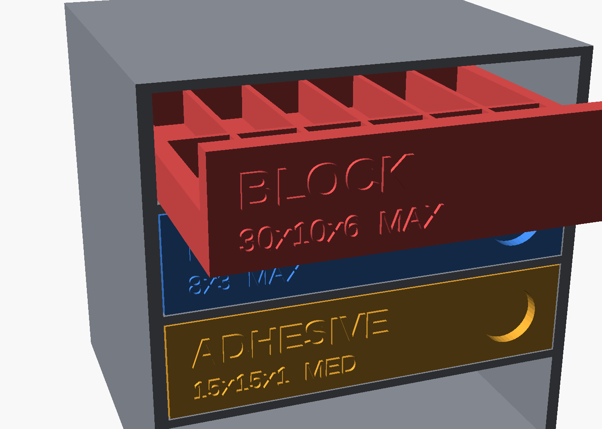

# Skådis Magnet Cabinet

A 3D-printed cabinet that hangs on an IKEA Skådis board. Each magnet type gets its own
slide-out drawer with a raised label on the front (name, size, strength), so you can throw
the blister packs away and still know what's what. One drawer slot is left empty for
whatever you buy next.

## What it stores (from the photo)

| Drawer   | Magnet (Everhang)              | Qty | Layout                                   | Capacity |
|----------|--------------------------------|-----|------------------------------------------|----------|
| BLOCK    | 30 x 10 x 6 mm, max strength   | 6   | flat, 1 per pocket, 6 x 2 pockets        | 12       |
| DISC     | 8 x 3 mm, max strength         | 10  | stacks of 4, 7 x 3 pockets               | 84       |
| ADHESIVE | 15 x 15 x 1 mm, medium         | 10  | stack of 10 per pocket, 4 x 2 pockets    | 80       |
| (empty)  | spare slot                     |     |                                          |          |

**Measure your magnets with calipers before printing.** The block thickness (6 mm) is my read of
the photo plus a [Bunnings listing](https://www.bunnings.co.nz/everhang-30-x-10mm-magnet-block-pack-of-6_p0519740)
that gives 30 x 10 x 6; the packaging only shows the 30 mm length. Pockets get 0.2 mm
clearance per side (`mag_clr`).

## Design

- **Cabinet** 80 x 73 x 80 mm, open front, 4 cells. 80 mm wide = 2 hole pitches and 80 mm tall =
  2 pitches, so extra cabinets tile on the board by shifting in multiples of 40 mm. (Community
  Skådis grid organizers report units drifting off the hole spacing; keeping everything on the
  40 mm grid avoids that.)
- **4 hooks** (2 x 2, 40 mm apart each way) lock it to the board and stop it rocking when you
  pull a drawer. It prints on its side wall so the hook layers run along the load, with no
  supports needed except under the hooks.
- **Drawers** slide on the shelves with a small detent bump so they don't creep open. Pockets are
  open-top; each has a push-out hole in the floor, so you push a stack up from below instead of
  prying it out with a fingernail.
- **Stacks, not loose piles**: discs and adhesive magnets stack in a pocket (they self-align),
  blocks lie flat in separate pockets. Walls between pockets are 1.2 mm.
- **Expansion**: add a row to `MAGNETS` in `magnet_cabinet.scad` (name, spec text, rect/disc,
  dimensions, stack, cols, rows). The drawer is generated and the label updates. Need more
  slots? Print another cabinet and hang it 80 mm to the side or below.

## Prior art checked

Existing models are either dispensers ([Magnet Storage](https://makerworld.com/models/2778107),
80 magnets per unit), boxes ([MagStack](https://www.printables.com/model/700497-the-magstack-rugged-box)),
or generic Skådis bins/drawers ([modular drawer frame](https://makerworld.com/models/2310974),
[grid organizer](https://makerworld.com/models/2461308)). I found none that combines Skådis hanging, per-type labelled
drawers and a parametric magnet list. Ideas borrowed: stacking, pole awareness (below), 40 mm-grid sizing.

## Before you print

1. **Print the coupon first** (`stl/coupon.stl`, ~15 min). Hook it on your board. Slot geometry
   here (5 x 15 mm slots, 5 mm board, 40 mm pitch, checkered layout) comes from community sources, not an
   IKEA spec. If it's tight raise `fit`; if it wobbles, lower it. Also check the four hooks land in
   holes: two in one row 40 mm apart, and the same pair 40 mm higher.
2. Print the carcass on its side (the STL is already rotated), **supports on build plate only /
   painted under the hooks**.
3. Print drawers as exported (tray down, pockets up). No supports.

**Settings:** PETG (or PLA+), 0.2 mm layers, 4 walls, 15-20 % infill. Don't use a steel-tipped
nozzle tool or a magnetic build-plate trick to remove parts with the magnets nearby.

## Safety and loading

- Load neighbouring pockets with **alternating polarity** (N up, S up, ...). Same-pole neighbours
  repel and try to flip out; alternate poles clamp each other in place. Mark one face of each
  magnet with a paint pen if they aren't already marked.
- Max-strength neodymium pinches skin hard and can shatter if two collide. Slide magnets apart
  sideways, never pull them straight off each other.
- Keep the cabinet away from pacemakers, phones/cards and the printer's electronics, and out of reach
  of children: swallowed magnets are an emergency.
- The 1.2 mm walls only separate magnets; they do not shield. Don't hang it next to steel tools you
  don't want magnetised or grabbed.

## Files

- `magnet_cabinet.scad` — parametric source (`part = assembly | carcass | drawer | coupon`)
- `stl/` — `coupon.stl`, `carcass.stl`, `drawer_0.stl` (BLOCK), `drawer_1.stl` (DISC), `drawer_2.stl` (ADHESIVE)
- Regenerate: `openscad -D 'part="drawer"' -D 'drawer_index=0' -o stl/drawer_0.stl magnet_cabinet.scad`

## Not verified

Rendered and dimension-checked in OpenSCAD only; nothing has been printed or hung on a real board.
Expect to tune `fit`, `mag_clr` and the detent bump after the first print.
